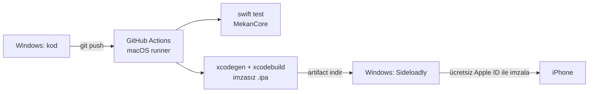

# Mekan — Sistem Mimarisi

LiDAR ile oda tarama, ölçü çıkarma ve AI destekli iç mimari yeniden tasarım.
Native iOS uygulaması (SwiftUI + RoomPlan). Geliştirme ortamı yalnızca Windows,
dağıtım ücretsiz Apple ID ile sideload.

## 1. Teknoloji seçimi ve gerekçesi

| Seçenek | LiDAR / mesh | Oda yapısı (duvar, kapı, eşya) | Sonuç |
|---|---|---|---|
| Saf web (WebXR, Safari) | Yok. iOS Safari `immersive-ar` desteklemez, LiDAR derinliği verilmez | Yok | **Yetersiz** |
| React Native / Flutter | Native modül yazmadan yok (sonuçta yine Swift) | RoomPlan'e köprü gerekir | Ek katman, kazanç az |
| **Native SwiftUI + RoomPlan** | ARKit sceneReconstruction | Duvar/kapı/pencere/eşya + ölçüler hazır | **Seçildi** |

RoomPlan: iOS 16+ ve LiDAR'lı cihaz (iPhone 12 Pro ve sonrası Pro modeller,
LiDAR'lı iPad Pro). Uygulama hedefi iOS 17.

## 2. Windows'tan iPhone'a ücretsiz akış



Sınırlar (ücretsiz Apple ID): uygulama 7 günde bir yeniden imzalanır, aynı anda en
fazla 3 sideload uygulaması. Public repoda Actions macOS dakikaları ücretsiz;
private repoda aylık kota düşük (macOS dakikası 10× sayılır).

## 3. Uygulama bileşenleri

```mermaid
flowchart TB
  subgraph App["Mekan (iOS app target)"]
    SV[ScanView\nRoomCaptureView sarmalayıcı] -->|CapturedRoom| CV[RoomScanConverter]
    SV -->|ARFrame| PH[Oda fotoğrafı]
    CV --> ST[(ScanStore\nDocuments/scans/&lt;id&gt;)]
    SV -->|export| USDZ[room.usdz]
    USDZ --> ST
    PH --> ST
    ST --> DV[ScanDetailView\nölçüler · 2D plan · 3D QuickLook]
    DV --> RV[RedesignView\nstil seçimi]
    RV --> IP{{ImageProvider}}
    IP --> OAI[OpenAI Images\nedits / generations]
    KC[(Keychain\nAPI anahtarı)] --> OAI
    OAI --> ST
  end
  subgraph Core["MekanCore (Swift Package, platformdan bağımsız)"]
    RS[RoomScan şeması]
    RM[RoomMeasurements]
    PB[PromptBuilder]
  end
  CV --> RS
  DV --> RM
  RV --> PB
```



`MekanCore` RoomPlan/UIKit'e bağlı değildir. Bu sayede ölçü ve prompt mantığı
macOS'ta `swift test` ile test edilir.

## 4. Veri sözleşmesi: `RoomScan` (v1)

RoomPlan'in kendi `Codable` çıktısı sürüme bağlı ve simd matrisleri içerir. Bu
yüzden kendi sade şemamızı saklarız. Birim metre, Y yukarı, zemin düzlemi XZ.

```jsonc
{
  "version": 1,
  "id": "UUID",
  "name": "Salon",
  "capturedAt": "2026-11-08T10:00:00Z",
  "walls":    [{ "id": "…", "start": {"x":0,"z":0}, "end": {"x":4.2,"z":0}, "height": 2.7 }],
  "openings": [{ "id": "…", "kind": "door", "wallId": "…",
                 "center": {"x":1,"y":1,"z":0}, "width": 0.9, "height": 2.0 }],
  "objects":  [{ "id": "…", "category": "sofa",
                 "center": {"x":2,"y":0.4,"z":1}, "size": {"x":2,"y":0.8,"z":0.9}, "yaw": 0 }]
}
```

`RoomMeasurements` şunları türetir:
- **en / boy:** en uzun duvarın yönüne hizalanmış sınır kutusu
- **tavan:** en yüksek duvar
- **zemin alanı:** duvarlar uçlarından zincirlenip kapalı poligon oluşursa shoelace
  formülü; zincir kapanmazsa sınır kutusu alanı (`isAreaEstimated = true`)
- **çevre:** duvar uzunlukları toplamı
- kapı, pencere ve eşya sayıları

## 5. AI pipeline

1. **Girdi:** tarama, stil (Japandi, İskandinav…), isteğe bağlı ek not, oda
   fotoğrafı (tarama bitince ARKit'in son karesi).
2. **PromptBuilder:** ölçüleri, açıklıkları ve eşya listesini İngilizce doğal dile
   çevirir. Amaç, modelin oranları, pencere/kapı yerlerini ve yerleşimi korumasıdır.
3. **Sağlayıcı:** `ImageProvider` protokolü.
   - `OpenAIImageProvider`: fotoğraf varsa `/v1/images/edits` (fotoğrafı yeniden
     tasarla), yoksa `/v1/images/generations`. Model adı ayarlardan değişir.
   - İleride `ReplicateControlNetProvider`: fotoğraf + MLSD/depth ControlNet ile
     geometriye daha sadık sonuç.
4. **Çıktı:** PNG, taramanın `renders/` klasörüne kaydedilir ve galeride gösterilir.

İleri adım: USDZ'den derinlik haritası render edip ControlNet depth'e vermek.

**Güvenlik notu:** API anahtarı cihazda Keychain'de durur. Bu kişisel kullanım
için yeterli. Uygulama başkalarına dağıtılacaksa anahtar bir sunucu proxy'sine
taşınmalı (`web/` iskeleti bu amaçla duruyor).

## 6. Klasör yapısı

```
mekan/
  .github/workflows/ios.yml   test + imzasız .ipa
  docs/architecture.md
  docs/kurulum.md             Windows → iPhone adım adım
  ios/
    project.yml               XcodeGen proje tanımı (.xcodeproj CI'da üretilir)
    MekanCore/                Swift Package: şema, ölçü, prompt (+ testler)
    Mekan/                    SwiftUI uygulaması
      Scan/                   RoomPlan tarama
      Scans/                  depolama, liste, detay, plan çizimi
      AI/                     sağlayıcılar, redesign ekranı, ayarlar
  web/                        (beklemede) ileride AI proxy / paylaşım sitesi
```

## 7. Sonraya bırakılanlar

- Replicate ControlNet sağlayıcısı
- USDZ'den derinlik haritası
- Tarama paylaşımı / web görüntüleyici
- Birden fazla odayı birleştirme (RoomPlan `StructureBuilder`, iOS 17)
